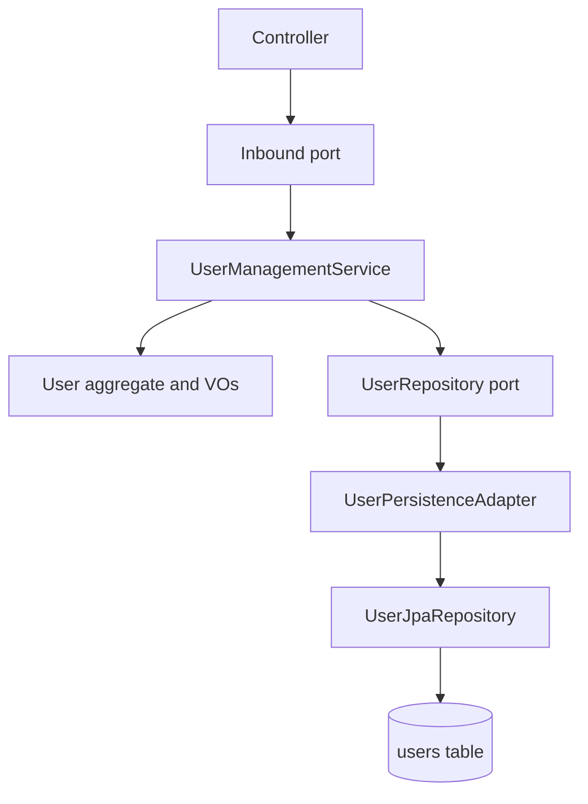

# Plan: Repair the `user` module (compile errors, password logic, adapter/schema drift)

## Context

The `user` service follows hexagonal architecture but currently does not compile cleanly, has an
inverted password-change rule, and its persistence adapter + Flyway schema do not match the JPA
entity. This plan fixes those three areas without redesigning the architecture.

Affected layers:

## Assumptions

1. The existing `V1__create_user_table.sql` has never been applied successfully (it contains syntax
   errors), so it can be rewritten in place rather than superseded by a `V2` migration.
2. A single `users` table is the intended design. The `passwords` / `users_passwords` tables in the
   current SQL are leftovers and will be removed.
3. `UserJpaEntity` should extend `JpaEntityBaseModel` so `created_at` / `updated_at` are managed by
   JPA auditing (already enabled via `@EnableJpaAuditing` on `UserApplication`).
4. `SecurityConfig` staying `permitAll` is out of scope; only the `PasswordEncoder` bean is used.

## Phase 1 - Restore compilation

1. `ports/outbound/user/UserRepository`: add the missing `List<User> findAll()` and `long count()`
   declarations used by `UserManagementService`.
2. `adapters/inbound/rest/user/UserController`:
   - call `suspend(username)` / `delete(username)` to match the port names;
   - pass `username` (not `UserId`) to `changePassword` and drop the redundant
     `findUserByUsername` pre-lookup.
3. `application/user/UserManagementService`:
   - add `@Override` to `suspend`, `reActive`, `delete`;
   - stop importing the adapter DTO `adapters/inbound/rest/user/UpdateUserRequest`.
4. Introduce `ports/inbound/user/UpdateUserCommand` (firstname, lastname, Email, BirthDate) and
   change `UserManagementUseCase.update` + `UserManagementService.update` to accept it. Delete the
   duplicate `ports/inbound/rest/user/UpdateUserRequest` and keep the adapter record as the REST
   shape that maps to the command.

## Phase 2 - Fix password logic

5. `domain/user/User.changePassword(Password)`: remove the inverted comparison. The aggregate should
   only reject a null password; "must differ" is an encoding concern and belongs in the service.
6. `UserManagementService.changePassword`: verify with
   `passwordEncoder.matches(oldRawPassword, user.getPassword().getHash())` and throw
   `PasswordWrongExeption` when it fails; then encode and apply the new password.
7. Align password policy: keep the strong rule in `Password.validate` (upper + lower + digit +
   special, min 8), and make `UserManagementService.validatePassword` delegate to the same rule
   instead of the weaker alphanumeric-only rule. Fix the `"Wick Password"` typo.

## Phase 3 - Fix persistence adapter drift

8. `UserJpaEntity`: extend `JpaEntityBaseModel`, remove the duplicated `id` field, add an `email`
   column, use `LocalDate` for `birthday`, and add an `updateFrom(...)` method (or setters) so
   firstname / lastname / email / birthday can be persisted.
9. `UserPersistenceAdapter`:
   - `mapToJpaEntity` must map every field (id, username, status, password hash, firstname,
     lastname, email, birthday);
   - `save` must load the existing entity when present and mutate it, so auditing timestamps and
     fields are preserved (mirrors the `Role` adapter pattern described in `CLAUDE.md`);
   - `mapToDomain` must preserve status / email / birthday (use a rehydration path rather than the
     `User.create` constructor that forces `PENDING`).
10. `UserJpaRepository`: declare the derived queries the adapter needs - `findByStatus`,
    `countByStatus`, `findByUsernameContaining`, `findByEmailContaining`,
    `findByFirstnameContaining`, `findByLastnameContaining`.
11. Implement all `UserRepository` methods in `UserPersistenceAdapter` (`findByStatus`,
    `countByStatus`, the four `*Containing` searches, `findAll`, `count`).

## Phase 4 - Fix schema drift

12. Rewrite `V1__create_user_table.sql` as a single `users` table matching the entity exactly:
    `id UUID PK`, `username VARCHAR(255) NOT NULL UNIQUE`, `user_status VARCHAR(255) NOT NULL`,
    `password VARCHAR(255) NOT NULL`, `firstname`, `lastname`, `email`, `birthday DATE`,
    `created_at TIMESTAMP NOT NULL`, `updated_at TIMESTAMP NOT NULL`. Remove the broken double
    commas and the `passwords` / `users_passwords` tables.
13. Confirm `spring.jpa.hibernate.ddl-auto=validate` passes against the new migration.

## Phase 5 - Boundary hygiene (small, keeps the API correct)

14. `UserResponse`: stop exposing the password hash (drop the field or replace with a boolean), and
    keep `id` as a plain UUID in the response payload.
15. Add Jackson support to `Email` (`@JsonCreator`) and `BirthDate` (`@JsonCreator` on a
    `LocalDate`/ISO string) so they can be deserialized from request bodies; make `BirthDate`
    null-safe.
16. Add a `@RestControllerAdvice` mapping `UserNotFoundException` -> 404,
    `PasswordWrongExeption` -> 400, and domain `IllegalArgumentException`/`IllegalStateException`
    -> 400/409, so failures do not surface as 500s.

## Phase 6 - Verification

17. Build: `mvn -pl user -am clean test -DskipTests=false` (compile + unit tests).
18. Add unit tests for `User` status transitions and `UserManagementService.changePassword`
    (success + wrong old password), plus an adapter mapping test for round-tripping all fields.
19. Optional: enable `UserApplicationTests` with the Testcontainers Postgres configuration and
    assert the context loads against the migrated schema.

## Out of scope

- Real authentication/authorization (currently `permitAll`).
- Cross-service integration with `access-control`.
- Pagination / sorting for the list endpoints.
